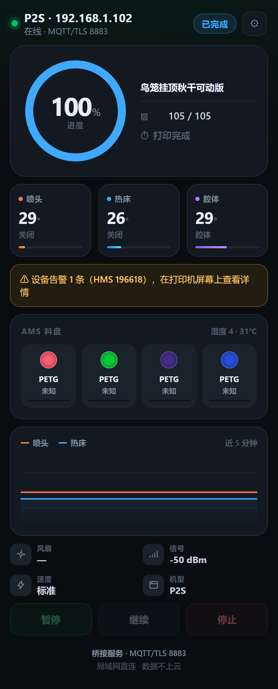

# 五分钟跑起来

给第一次用的人看的最短路径。完整功能和原理见 [README.md](README.md)。



---

## 你需要准备

- 一台拓竹打印机（Bambu Lab），和电脑在同一个 WiFi / 局域网
- 电脑上装了 **Node.js 18 或更高版本**

不需要注册账号，不需要连拓竹云，数据不出你家内网。

## 第一步：打印机上开局域网模式

打印机屏幕 → **设置 → 网络** → 打开「**局域网模式（LAN Only）**」。

记下同一页上的两个值：

- **IP 地址**，例如 `192.168.1.100`
- **访问码（Access Code）**，8 位

> 只想看状态和温度，做到这里就够了。
>
> 还想让页面上的**暂停 / 继续 / 停止**真的生效，需要在同一页再打开
> 「**开发者模式（Developer Mode）**」。
> 代价是开发者模式下打印机不能连拓竹云，手机上的 Bambu Handy 会连不上。

## 第二步：装 Node.js

到 <https://nodejs.org/zh-cn/download> 下载 **LTS** 版本，安装时一路点「下一步」用默认选项。

装完打开命令行，输入：

```bash
node -v
```

能看到类似 `v22.22.2` 就说明装好了。看不到就重开一个命令行窗口再试。

## 第三步：启动

**Windows**：双击项目里的 `start.bat`

**macOS / Linux**：在项目目录执行 `./start.sh`

第一次运行会自动安装依赖（大约 10 秒，需要联网）。成功后窗口里会显示：

```
本机访问   http://localhost:8848
手机访问   http://192.168.1.100:8848
```

浏览器会自动打开。点右上角 **⚙**，填入：

| 要填的 | 填什么 |
|---|---|
| 打印机 IP | 第一步记下的 IP |
| 访问码 | 第一步记下的 8 位码 |
| 打印机型号 | 下拉选你的机型 |

点「连接」。看到温度和打印进度在动，就通了。

## 手机上看

手机连**同一个 WiFi**，浏览器打开上面那个「手机访问」地址。

- iPhone：Safari 分享 → 添加到主屏幕
- 安卓 Chrome：菜单 → 安装应用

用起来和 App 一样，不需要装东西。

---

## 常见问题

**双击 start.bat 窗口一闪就没？**

没装 Node.js。装完重新双击。窗口里任何报错都会停在原地等你看，不会直接关掉。

**连不上，页面一直是演示模式？**

按顺序排查：

1. IP 填错 —— 回打印机屏幕「设置 → 网络」再确认
2. 电脑和打印机不在同一网段（比如电脑连了 5G WiFi、打印机连了 2.4G 的另一张网）
3. 打印机没开「局域网模式」
4. 访问码填错 —— 是 8 位访问码，**不是 WiFi 密码**

**摄像头是黑的？**

- 需要电脑装了 `ffmpeg`。Windows 可以 `winget install ffmpeg`，macOS 可以 `brew install ffmpeg`
- 没装 ffmpeg 不影响其他所有功能，只是摄像头用不了
- P1S / A1 / A1 mini / P1P 的摄像头走另一套协议，**当前版本看不了**，详见 README 的机型表

**暂停 / 停止点了没反应？**

打印机没开「开发者模式」。开启后，回执会从「命令被拒」变成「已执行」。

另外注意：**任务空闲或已完成时，三个按钮本来就是灰的**，这是正常行为 —— 没有任务可以暂停。

**打印机 IP 过几天就变了？**

在路由器管理页面给它绑定一个**静态 IP**，否则 DHCP 重新分配后要改配置。

**想让它在家里一直活着（不用开着电脑）？**

丢到 NAS 上跑，见 [DEPLOY-NAS.md](DEPLOY-NAS.md)。家里任何设备打开就是已连接状态。

**只想先看看界面长什么样？**

不用打印机，直接打开 `http://localhost:8848/?demo=1`，是模拟数据。

## 还有 Android APK

`apk/bambu-dash.apk` —— 装到手机上**直连打印机**，不需要电脑开着桥接服务。

装的时候要允许「未知来源」。如果之前装过同名的旧版本，先卸载再装。
