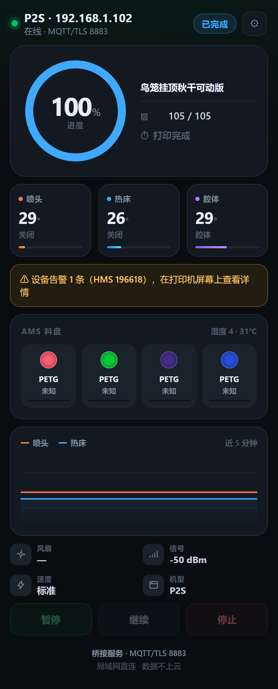

# Bambu P2S 看板

给拓竹 P2S 做的实时状态看板。网页版 + Android APK 两个形态，数据全程走局域网，
不经过任何云端服务器。



> 上图是实机截图：P2S 上的打印任务"鸟笼挂顶秋千可动版"已完成，105 层。

## 能看什么

| 项目 | 说明 |
|---|---|
| 打印进度 | 大环 + 百分比 + 剩余时间 + 预计完成时刻 |
| 当前文件 | 文件名、当前层 / 总层数 |
| 温度 | 喷头、热床、腔体（当前值 / 目标值 / 进度条） |
| AMS | 4 个料盘的颜色、耗材类型、余量，当前使用的高亮 |
| 风扇 / 信号 / 速度档 | 实时数值 |
| 温度曲线 | 最近 5 分钟喷头与热床走势，含目标虚线 |
| 摄像头 | 实时画面（MJPEG），点开即看，点关即停 |
| 舱内灯 | 一键开关，按钮会跟着真实状态高亮 |
| 异常 | `print_error` + HMS 告警（按等级分级：错误/警告/提醒） |
| 控制 | 暂停 / 继续 / 停止 / 舱内灯（需打印机开启开发者模式） |

---

## 一、网页版（最快）

双击 `start.bat`，或者在命令行里：

```bash
node bridge/server.js
```

然后打开 `http://localhost:8848`。手机连同一个 WiFi，访问启动时打印的那个
`http://192.168.x.x:8848` 即可。iPhone 可以「添加到主屏幕」，安卓 Chrome 可以
「安装应用」，用起来和 App 差不多。

桥接服务的作用：打印机只开放 MQTT over TLS（8883 端口），浏览器没法直接连
TCP，需要它做一层转发。

### 想 7×24 常驻？丢到 NAS 上跑

电脑关机/休眠看板就断了。想让它在家里一直活着，最舒服的地方是 NAS ——
项目里已经备好 Docker 方案（飞牛 fnOS、群晖、极空间都通用）：

```
Dockerfile             镜像：node 20 + ffmpeg
docker-compose.yml     编排：host 网络 + 凭据从 .env 注入
.env.example           凭据模板，复制成 .env 再填
DEPLOY-NAS.md          逐步部署说明
```

填好 `.env` 之后，**任何设备打开 `http://NAS的IP:8848` 都是直接连好的状态**，
不用再输 IP 和访问码（访问码只存在服务端，不下发到浏览器）。

详细步骤见 [DEPLOY-NAS.md](DEPLOY-NAS.md)。

## 二、APK（装手机上，不用开电脑）

```
apk/bambu-dash.apk
```

传到手机安装（需要允许「未知来源」）。APK 里内置了 MQTT/TLS 客户端，
**直接连打印机，不依赖电脑上开着桥接服务**。

> APK 是用自己生成的密钥签名的（`apk/release.jks`），没上架应用商店。
> 如果手机上已经装过同包名的旧版本，先卸载再装。

## 三、只看效果

打开 `http://localhost:8848/?demo=1`，用模拟数据跑一遍完整界面，不需要打印机。

---

## 打印机端要做的设置

1. 打印机屏幕 → **设置 → 局域网模式(LAN Only)** → 打开
2. 记下这一页上的 **访问码（Access Code）** 和 **IP 地址**
3. 在网页/App 里填入这两项，点连接

序列号不用填 —— 桥接服务和 APK 都会订阅 `device/#`，从收到的报文 topic 里
自动反解出来（P2S 的 SSDP 发现是关的，扫不到，这条路更可靠）。

只做看板（只看不操作）**只需要 LAN Only**，不用开开发者模式。
如果要让看板上的暂停/继续/停止真的生效，还需要在同页面打开
**开发者模式(Developer Mode)** —— 那是打印机允许第三方写入的总开关。

开启后校验解除，控制类命令才会被接受；关掉开发者模式后，命令会重新被拒并
在打印机屏幕上记一条「MQTT 命令校验失败」。

## 控制按钮什么时候能点

三个按钮是**严格跟随真实状态**的，只有能执行的时候才亮：

| 打印机状态 | 暂停 | 继续 | 停止 | 提示文字 |
|---|---|---|---|---|
| 打印中 `RUNNING` | ✅ | — | ✅ | 打印中 · 可暂停或停止 |
| 已暂停 `PAUSE` | — | ✅ | ✅ | 已暂停 · 可继续或停止 |
| 准备中 `PREPARE` | — | — | — | 准备中（预热/调平） |
| 已完成 `FINISH` / 空闲 `IDLE` | — | — | — | 没有正在执行的任务 |

**空闲时三个按钮全灰是正常行为**，不是功能没做——没有任务可以暂停。
在打印机屏幕上或 Bambu Studio 里点开始打印后，按钮会自动亮起。

判断「命令到底通没通」不用看按钮亮不亮，看回执：

- `已执行 · 暂停` → 成功
- `命令未执行 · ERROR STATE` → 通了，但当前状态不允许（比如空闲时想暂停）
- `命令被拒：开发者模式未开启` → 卡在授权校验

`ERROR STATE` 的 `err_code` 是 0，而没开开发者模式时是 `84033543`（`mqtt message
verify failed`）。**看 err_code 是否消失，就知道授权通没通。**

**摄像头需要 ffmpeg**（网页版靠桥接服务把 RTSPS 转 MJPEG）。已装则自动使用，
也可用环境变量 `FFMPEG_PATH` 指定路径。没有 ffmpeg 时看板其余功能不受影响，
摄像头卡片会提示连接失败。**APK 不需要 ffmpeg**，它走原生路径（见下）。

## APK 里的摄像头是怎么做的

打印机 322 端口只收 TLS 加密的 RTSP，请求行必须是 `rtsps://`，认证是
HTTP Digest（LIVE555），`/streaming/live/1` 还会回 301。安卓自带的播放器
只会说明文 `rtsp://`，WebView 更是完全不支持 RTSP——直接连一定失败。

于是 APK 在本地起一个**隧道**（`RtspTunnel.java`）：

```
MediaPlayer → rtsp://127.0.0.1:<随机端口>/...  →  隧道  →  rtsps://打印机:322/...
```

隧道替播放器做了四件事，播放器看到的永远是干净的 `200 OK`：

| 麻烦 | 隧道怎么处理 |
|---|---|
| TLS | 自己握手（不校验打印机自签证书） |
| 请求行必须 `rtsps://` | 把本地 `rtsp://` 改写成 `rtsps://打印机:322` |
| Digest 认证 | 吞掉 401、算 MD5 摘要、内部重发，播放器不用知道访问码 |
| 301 跳转 | 内部跟随 `Location`，不把重定向抛给播放器 |
| 响应里的绝对地址 | 改写成 `rtsp://127.0.0.1:端口`，否则播放器会绕过隧道直连打印机 |

视频数据**不经过隧道**：实测打印机支持 UDP 传 RTP，所以保留播放器原始的
UDP 协商，画面由打印机直接发到手机上，延迟更低。代价是手机与打印机必须在
同一网段、且路由器没开 AP 隔离。

这套链路用 ffmpeg 当"假播放器"在桌面完整验证过（默认 UDP 协商、不提供凭据、
隧道自己认证），能稳定抓到 1080p 画面。

## 实测记录

用一台 P2S（固件为 2026 年初版本）实测验证过：

| 验证项 | 结果 |
|---|---|
| MQTT over TLS 8883 连接 | ✓ 872ms |
| TLSv1.2 握手（自签证书） | ✓ |
| `device/#` 订阅 | ✓ |
| 序列号自动反解 | ✓ |
| pushall 触发全量 | ✓ |
| 报文解析（8112 字节/次，约 2 秒一次） | ✓ |
| APK 内 MQTT 客户端 | ✓ 同一份 Java 代码在桌面 JVM 连通真机，4.8 秒收到 3 条 |
| 摄像头 RTSPS 322 | ✓ 1920×1080@30fps，转 MJPEG 实测 8 秒 80 帧 |
| 舱内灯 `system.ledctrl` | ✓ 无需开发者模式即生效，`lights_report` 会跟着变 |
| FTPS 990 | ✓ 可列 3MF / 上传 / 删除（implicit TLS） |
| 开发者模式后的 `print.*` | ✓ 错误码从 `84033543 verify failed` 变为 `ERROR STATE` |
| SSDP / mDNS 自动发现 | ✗ 组播单播都无响应，P2S 上这条路不通 |

APK 未做真机安装验证（本机没有 Android 模拟器），WebView 与 JSBridge 那层是标准
用法，传输层已经独立验证过了。

## 跑起来之后

- 打印机空闲时也会每秒推一次状态，看板会自动进入待机画面
- 断网/断电后会自动重连，退避最长 15 秒
- 数据只在局域网内传输，访问码存在本机（网页是 localStorage，APK 是 SharedPreferences）

---

## 常见问题

**连不上 / 一直显示"连接中"**
- 确认手机和打印机在同一网段，且路由器没开「AP 隔离」
- 访问码是打印机 LAN Only 页面上那个 8 位字符，不是 Bambu 账号密码
- 关掉电脑防火墙对 8883 的拦截（若用网页版，是电脑访问打印机）

**提示"访问码不正确"**
访问码区分大小写，注意别把 `0` 和 `O`、`1` 和 `I` 弄混。

**网页版能看，APK 看不了**
APK 要求手机本身能访问打印机 IP。如果手机在访客 WiFi、打印机在主网络，就连不上。

**为什么 P2S 用的是 P1S 的协议**
P2S 的 MQTT 报文结构与 P1S 一致（没有 X1 系列的 `mc_print_stage` 那套逻辑），
本项目的字段解析按 P1S 方言处理。

**打印机屏幕上冒出「MQTT 命令校验失败 / HMS 0500-0500-0001-0007」**
这不是故障，也不是固件坏了。它是打印机在告诉你：**有第三方软件发了控制命令，
但授权校验没过，被拒收了**。

- 触发条件：本看板（或任何第三方工具）在**没开开发者模式**的情况下发了
  `print.*` 类的写命令（暂停/继续/停止、开始打印、发 G-code）
- 它记录的位置：打印机屏幕的「助手」页面，每被拒一次就记一条
- 对打印的影响：**没有**。只看状态不会触发它，也不会中断任何打印任务
- 怎么消掉：在打印机上开「开发者模式」（设置 → 仅局域网 → 开发者模式），
  校验条件解除后这条记录会自行消失
- 看板这边：已经识别这个码，会显示成"控制命令被打印机拒收"的人话提示，
  并且带 × 可以关掉

若你的打印机固件较老、没有开发者模式选项，那这条就永久存在 ——
它只是提示，忽略即可。

## P2S 报文里的几个坑

实机抓包后发现，不能照抄 P1S 的字段假设：

| 现象 | 实际情况 | 处理 |
|---|---|---|
| `chamber_temper` 不存在 | 腔温在 `print.info.temp` | 前端做了 fallback |
| `subtask_name` 是中文 | 例如"鸟笼挂顶秋千可动版" | 直接显示，已做 HTML 转义 |
| AMS `remain` 为 `-1` | 非原厂耗材没有 RFID 余量 | 显示"未知"，不显示 0% |
| `print_error` 为 0 但有告警 | 告警在 `hms` 数组里 | 单独渲染 HMS 提示条 |
| `wifi_signal` 是字符串 | `"-50dBm"` | 去掉单位再转数字 |
| 多了个 `3D` 键 | 固件把层数又塞了一份进去 | 忽略 |
| 一次报文 8KB | `device`/`ipcam`/`xcam` 等大块用不上 | 只取 `print`，其余丢弃 |

## 一个容易踩的坑

MQTT 规范不允许 PUBLISH 的 topic 带通配符。所以：

- 订阅可以写 `device/+/report` 或 `device/#`
- 但发 pushall 必须用 `device/{精确序列号}/request`

一开始我用 `device/+/request` 发，连接不断、也不报错，但打印机就是不推数据，
排查了半天。现在的做法是先订阅 `device/#` 把序列号抓出来，再用精确 topic 发。

---

## 目录

```
bambu-dash/
├─ web/index.html        看板前端（单文件，无依赖，网页和 APK 共用）
├─ bridge/server.js      MQTT → WebSocket 桥接 + 静态托管 + SSDP 发现
├─ bridge/cam.js         摄像头：ffmpeg 把 RTSPS 转成 MJPEG / 单帧
├─ start.bat             Windows 一键启动
├─ Dockerfile            NAS 镜像（node 20 + ffmpeg）
├─ docker-compose.yml    NAS 部署编排（host 网络）
├─ .env.example          凭据模板（复制成 .env 再填，.env 不入库）
├─ DEPLOY-NAS.md         飞牛 NAS 部署步骤
├─ docs/dashboard.png    README 用的截图
├─ apk/
│  ├─ src/               MainActivity（WebView 壳）+ BambuClient（MQTT/TLS 客户端）
│  ├─ res/               图标
│  ├─ build.sh           免 Gradle 构建：aapt2 → javac → d8 → zipalign → apksigner
│  └─ bambu-dash.apk     成品
└─ LICENSE               MIT
```

### 重新构建 APK

```bash
cd apk && bash build.sh
```

需要 `ANDROID_SDK` 指向 SDK 根目录（默认 `D:/Program Files/Android/SDK`），
用 build-tools 35 + platform 33。改完 `web/index.html` 后要重新执行一次，
`build.sh` 会自动把它复制进 `assets/`。

## 还没做的

开发者模式开启后这些都通了，只是还没实现：

| 功能 | 难度 | 说明 |
|---|---|---|
| 开始打印 | 中高 | FTPS 上传 3MF 已通，还需拼 `project_file` 命令与切片参数 |
| 温度 / 风扇手动设置 | 低 | 走 `gcode_line`，如 `M104 S220`、`M106 S128` |
| AMS 进退料 | 中 | `ams_load_filament` / `ams_unload_filament`，需处理换料过程的状态机 |
| 3MF 缩略图文件库 | 中 | 3MF 是 zip，`Metadata/plate_1.png` 就是模型预览图 |
| 延时摄影 | 中 | ffmpeg 定时抓帧拼视频 |
| HMS 中文解释库 | 中 | 接官方 HMS 索引，把码翻成人话 |
